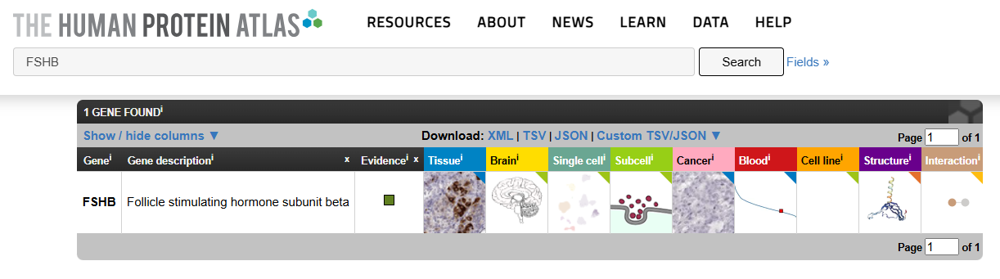
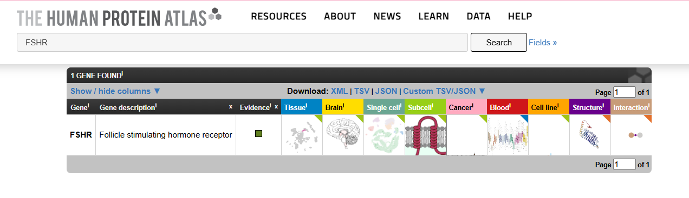

# Cell-to-Cell Communication: Pituitary Gonadotroph Signaling to Ovarian Granulosa Cells

## Biological Question

How does a pituitary gonadotroph communicate with ovarian granulosa cells through Follicle-Stimulating Hormone (FSH) signaling to regulate ovarian follicle development?

* * *

# 1\. Chosen Sender Cell and Biological Context

The chosen sender cell is the **Pituitary Gonadotroph**, an endocrine cell located in the anterior pituitary gland. Pituitary gonadotrophs produce and secrete reproductive hormones that regulate gonadal function.

The biological context of this study is female reproductive physiology, specifically ovarian follicle development and maturation. Communication occurs through endocrine signaling, in which hormones released by the pituitary travel through the bloodstream to target cells in the ovary.

* * *

# 2\. Candidate Ligand and Evidence for Sender-Cell Expression

The candidate signaling molecule is **Follicle-Stimulating Hormone (FSH)**.

FSH is synthesized and secreted by pituitary gonadotrophs. The **FSHB** gene encodes the beta subunit of FSH and serves as a marker associated with gonadotroph function.

## Evidence

-   **Human Protein Atlas:** Provides gene-expression information for FSHB in pituitary tissue.
-   **UniProt:** Describes FSH as a glycoprotein hormone involved in reproductive regulation, follicular development, and gonadal function.

**Ligand:** Follicle-Stimulating Hormone (FSH)

**Gene:** FSHB

### Screenshot: FSHB Expression


* * *

# 3\. Receptor and Receiver Cell with Supporting Evidence

The selected receptor is the **Follicle-Stimulating Hormone Receptor (FSHR)**.

The receiver cell is the **Ovarian Granulosa Cell**. Granulosa cells express FSHR and respond to circulating FSH. Activation of FSHR promotes granulosa-cell proliferation, estrogen production, and ovarian follicle development.

## Evidence

Human Protein Atlas data provide information about FSHR expression in ovarian tissue, supporting the selection of ovarian granulosa cells as biologically appropriate receiver cells.

**Receptor:** FSHR

**Receiver Cell:** Ovarian Granulosa Cell

### Screenshot: FSHR Expression


* * *

# 4\. Type of Cell-to-Cell Signaling

This pathway represents **Endocrine Signaling** because FSH is released by pituitary gonadotrophs into the bloodstream and travels to distant target cells in the ovary.

At the target cell, FSH binds to FSHR on the granulosa-cell membrane, initiating intracellular signaling that regulates follicular development and estrogen synthesis.

* * *

# 5\. OmniPath Findings

OmniPath was used to investigate the proposed ligand-receptor interaction between FSH and FSHR.

The interaction was examined using curated signaling resources, including CellCall and CellChatDB, where available. These resources help identify and assess candidate molecular interactions involved in cell-to-cell communication.

The findings support the proposed endocrine communication model between pituitary gonadotrophs and ovarian granulosa cells. Database evidence should be interpreted alongside the underlying interaction records and their supporting references.

### Screenshot: OmniPath Evidence

-→-FSHR-(P23945).png)
* * *

# 6\. STRING Network Interpretation

A STRING protein interaction network was generated to investigate proteins associated with FSHR-mediated intracellular signaling.

## Key Proteins

| Protein | Biological Significance |
| --- | --- |
| FSHR | Receives the extracellular FSH signal and activates intracellular signaling |
| GNAS | Encodes the stimulatory G-protein alpha subunit involved in activating adenylyl cyclase |
| ADCY5 | Encodes an adenylyl cyclase isoform that contributes to cyclic AMP (cAMP) production |
| PRKACA | Encodes the catalytic alpha subunit of Protein Kinase A (PKA) |
| CREB1 | Encodes a transcription factor involved in regulating gene expression |
| AKT1 | Encodes a protein kinase involved in cell survival, growth, and metabolism |
| MAPK1 | Encodes ERK2, a kinase involved in cell proliferation and differentiation |

## Enriched Pathway

The **cAMP signaling pathway** is a relevant pathway associated with FSHR activation.

Following FSH binding, FSHR activates a G-protein-mediated signaling cascade that can stimulate adenylyl cyclase activity and increase intracellular cAMP. cAMP activates Protein Kinase A, which regulates downstream proteins and transcription factors involved in granulosa-cell function.

The precise contribution of individual adenylyl cyclase isoforms and downstream proteins should be confirmed using the specific interaction and enrichment results.

### Screenshot: STRING Network


### Screenshot: STRING Enrichment


* * *

# 7\. IntAct Validation

An interaction associated with downstream Protein Kinase A signaling was examined using IntAct.

## Interaction Details

-   **Interaction examined:** PRKACA-PRKAR1A
-   **Organism:** Homo sapiens
-   **Detection method:** Anti-tag co-immunoprecipitation (anti-tag coIP)
-   **Interaction type:** Direct interaction
-   **Publication:** PMID: 24855271

## Interpretation

IntAct reports an interaction between PRKACA and PRKAR1A in humans, supported by experimental evidence and a published study. PRKACA encodes the catalytic alpha subunit of Protein Kinase A, whereas PRKAR1A encodes its regulatory subunit type I alpha.

This interaction is relevant to understanding the regulation of PKA signaling downstream of FSHR. However, evidence for an interaction between these proteins does not, by itself, establish every step of the proposed FSH signaling pathway.

### Screenshot: IntAct Evidence


* * *

# 8\. Answers to Required Questions

## 1\. What sender cell did you choose, and in what tissue or biological context does it act?

I selected the pituitary gonadotroph as the sender cell. It is located in the anterior pituitary gland and regulates reproductive function through endocrine hormone secretion. The biological context examined in this study is ovarian follicle development and maturation.

## 2\. What signaling molecule did you identify, and what evidence supports its production or presentation by the sender cell?

The signaling molecule identified was Follicle-Stimulating Hormone (FSH). Expression of the FSHB gene in pituitary tissue supports the production of the FSH beta subunit by pituitary gonadotrophs. Together with the known biological function of FSH, this supports its selection as the candidate signaling molecule.

## 3\. What receptor receives the signal, and which receiver cell did you select?

The receptor is FSHR, or Follicle-Stimulating Hormone Receptor. The selected receiver cell is the ovarian granulosa cell because these cells express FSHR and respond to FSH stimulation.

## 4\. What type of cell-to-cell signaling is represented?

This pathway represents endocrine signaling because FSH travels through the bloodstream from the anterior pituitary gland to target cells in the ovary.

## 5\. Which proteins in your STRING network appear most relevant to the receptor-associated response?

GNAS, ADCY5, PRKACA, CREB1, AKT1, and MAPK1 are relevant proteins because they are associated with intracellular signaling, cAMP production, transcriptional regulation, cell survival, and proliferation.

## 6\. What enriched pathway or biological process is consistent with your proposed mechanism?

The cAMP signaling pathway is consistent with the proposed mechanism. FSHR activation can stimulate G-protein-mediated adenylyl cyclase activity, increasing intracellular cAMP and activating Protein Kinase A.

## 7\. What did IntAct show for the molecular interaction you examined? What type of evidence was reported?

IntAct reported an interaction between PRKACA and PRKAR1A in Homo sapiens. The selected record lists anti-tag co-immunoprecipitation as the detection method and PMID: 24855271 as the publication reference.

## 8\. Which parts of your final model are strongly supported, and which parts remain an inference?

### Strongly Supported Components

-   Pituitary gonadotrophs produce and secrete FSH.
-   FSH acts on FSHR-expressing target cells, including ovarian granulosa cells.
-   FSHR activation can stimulate cAMP-dependent intracellular signaling.
-   PRKACA and PRKAR1A are associated with Protein Kinase A regulation.
-   FSH signaling contributes to granulosa-cell function and ovarian follicle development.

### Components Requiring Additional Evidence

-   The exact ligand-receptor database records supporting the proposed interaction.
-   The specific contribution of ADCY5 to the pathway in ovarian granulosa cells.
-   The precise order and directness of downstream interactions involving CREB1, AKT1, and MAPK1.
-   The extent to which each protein in the STRING network participates under the biological conditions studied.

## 9\. What cellular response is expected in the receiver cell, and why?

The expected cellular responses include:

-   Granulosa-cell proliferation
-   Increased estrogen production
-   Ovarian follicle development

These responses occur because FSHR activation stimulates intracellular pathways that regulate cell growth, differentiation, and hormone synthesis.

* * *

# 9\. Final Cell-to-Cell Communication Model

```plaintext
Pituitary Gonadotroph
          │
          ▼
         FSH
          │
     Bloodstream
          │
          ▼
Ovarian Granulosa Cell
          │
         FSHR
          │
          ▼
         GNAS
          │
          ▼
        ADCY5
          │
          ▼
         cAMP
          │
          ▼
       PRKACA
          │
          ▼
        CREB1
       /      \
    AKT1     MAPK1
       \      /
          ▼
Follicular Development
Estrogen Production
Granulosa Cell Proliferation
```

* * *

# 10\. Interpretation

This model describes endocrine communication between a pituitary gonadotroph and an ovarian granulosa cell. The sender cell, located in the anterior pituitary gland, synthesizes and secretes Follicle-Stimulating Hormone (FSH), which travels through the bloodstream to the ovary. There, FSH binds to the Follicle-Stimulating Hormone Receptor (FSHR) expressed on granulosa cells.

Receptor activation stimulates G-protein-mediated signaling involving GNAS, which can activate adenylyl cyclase and increase cyclic AMP (cAMP) production. Elevated cAMP activates Protein Kinase A, whose catalytic subunit is encoded by PRKACA. Downstream signaling can regulate transcription factors such as CREB1, while additional pathways involving AKT1 and MAPK1 contribute to cell survival, proliferation, and differentiation.

Together, these mechanisms support granulosa-cell function, estrogen synthesis, and ovarian follicle development. OmniPath provides evidence for candidate ligand-receptor interactions, STRING identifies functionally associated proteins and enriched pathways, and IntAct provides experimental evidence for selected molecular interactions. Overall, the evidence supports an endocrine signaling model in which pituitary gonadotrophs regulate ovarian follicle development through FSH-mediated activation of FSHR and downstream intracellular signaling pathways.

* * *

# 11\. References and Database Links

1.  **Human Protein Atlas**
    https://www.proteinatlas.org/

2.  **UniProt**
    https://www.uniprot.org/

3.  **OmniPath**
    https://omnipathdb.org/

4.  **STRING**
    https://string-db.org/

5.  **IntAct Molecular Interaction Database**
    https://www.ebi.ac.uk/intact/

6.  **PubMed (PMID: 24855271)**
    https://pubmed.ncbi.nlm.nih.gov/24855271/
